# BandControl for REAPER

[](https://github.com/nikarh/reaper-bandcontrol/actions/workflows/check.yml)
[](https://github.com/nikarh/reaper-bandcontrol/releases/latest)
[](https://github.com/nikarh/reaper-bandcontrol/releases)
[](https://github.com/nikarh/reaper-bandcontrol/stargazers)
[](LICENSE)
[](#requirements)
[](#reaper-extension)
[](#android-app)
[](https://nikarh.github.io/reaper-bandcontrol/)

Control REAPER from the band's phones over Bluetooth: playback and setlist, input and front of house levels, and a personal
in-ear mix for every band member.

BandControl is two parts: a **REAPER extension** (Windows, macOS, Linux) that turns the computer into a Bluetooth
Low Energy device, and an **Android app** that every band member installs. On a Mac the extension comes with a small
menu bar app that does the Bluetooth part for REAPER.

> **Status:** the Android app is the only client for now. An **iOS app is planned** but doesn't exist yet. The app
> is not on **Google Play** or **F-Droid** yet (both planned); install the APK from the
> [releases](https://github.com/nikarh/reaper-bandcontrol/releases/latest). The Linux Bluetooth backend is tested
> daily, the macOS one on an Apple silicon MacBook with macOS 15; the Windows backend is implemented but has only been
> tried on a few machines so far.

**Works with REAPER 5.93 and newer**, on Windows, macOS and Linux; see [requirements](#requirements).

## Features

<!-- features:start -->
<!-- Generated from docs/features.toml by scripts/build-docs.py, edit there. -->

### Playback and setlist

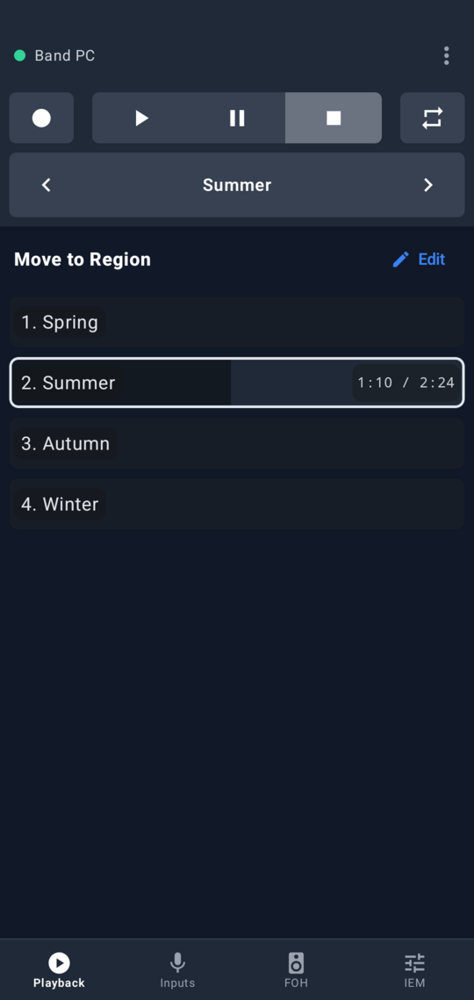

Play, pause, stop, record and repeat. The songs (regions) are listed in the band's order with their progress; tap one to jump to it. Previous / next step through the parts of a song (markers) and continue with the next song in the setlist.

<br clear="right">

### Setlist order

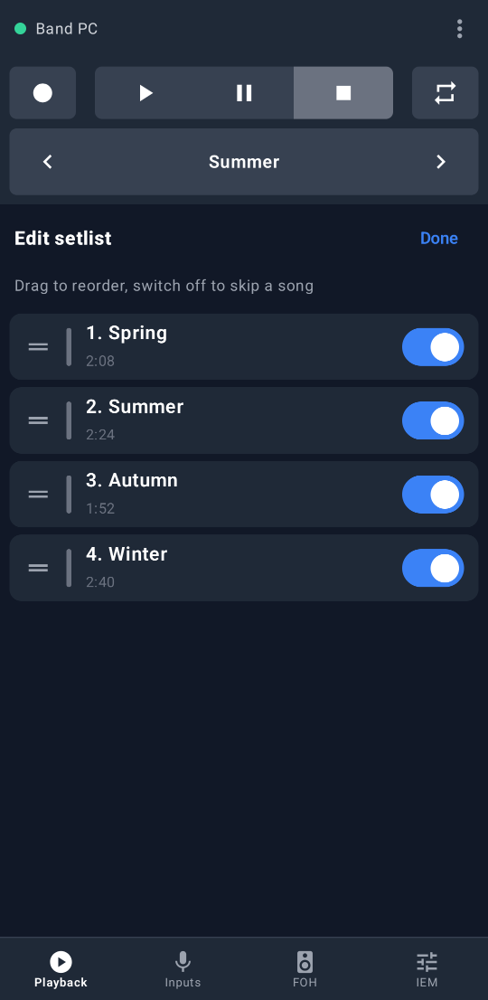

Tap Edit and drag songs by their handle, or long-press anywhere on a row, into tonight's order; switch a song off to skip it. The order is stored in the REAPER project, and every phone sees the change.

<br clear="right">

### Input levels and gain

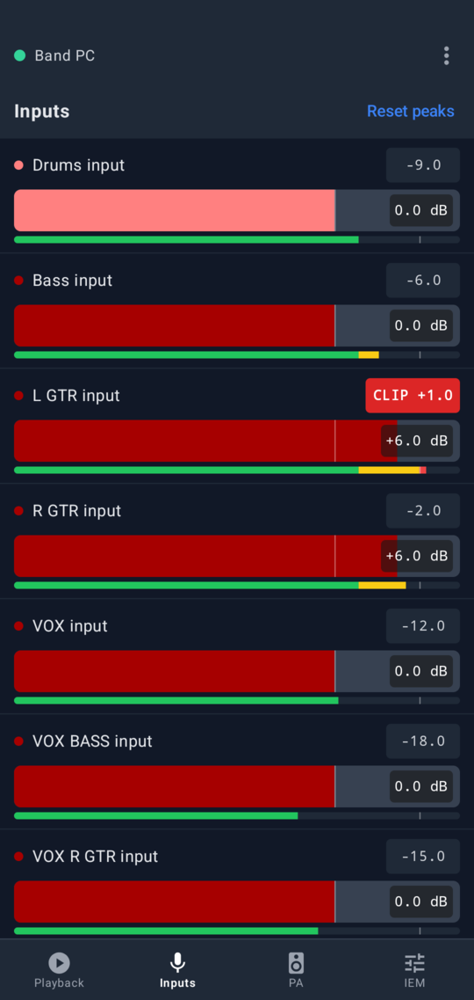

A meter for every input with its peak level, and a clip indicator that stays lit until you tap it. The fader sets the input's gain (its track volume), up to +12 dB.

<br clear="right">

### FOH outputs

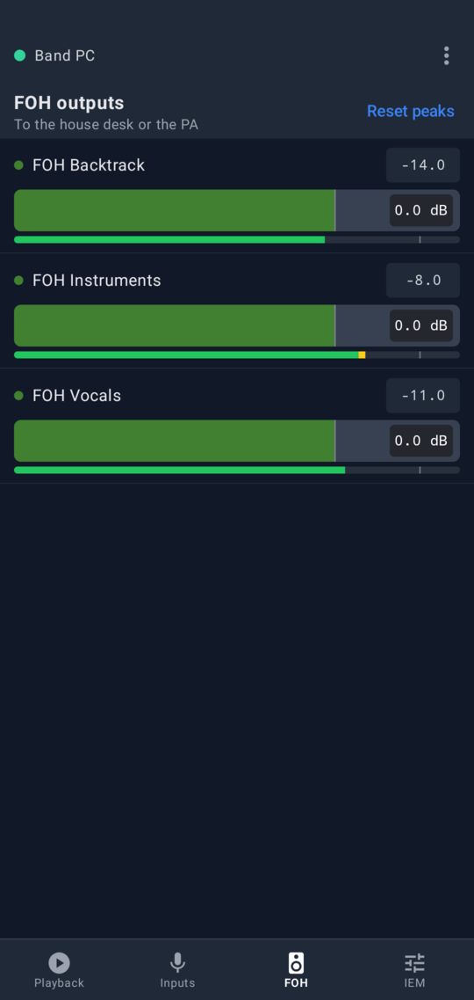

The same meters and faders for the front of house outputs: the feeds to the house desk or straight to the PA.

<br clear="right">

### Personal in-ear mixes

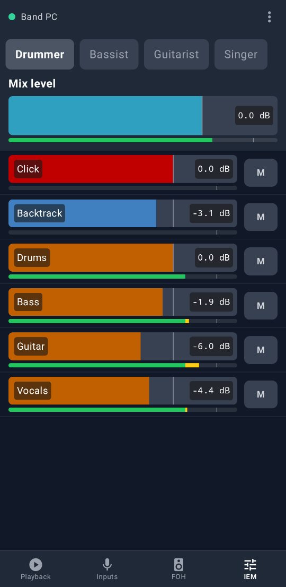

Every band member picks their own mix and sets the level and mute of each source: click, backtracks, other instruments, vocals, and the mix's overall level. Drag a fader sideways to move it; tapping or scrolling the list leaves it alone. Changes made in REAPER show up on the phones.

<br clear="right">

### Pairing by QR code

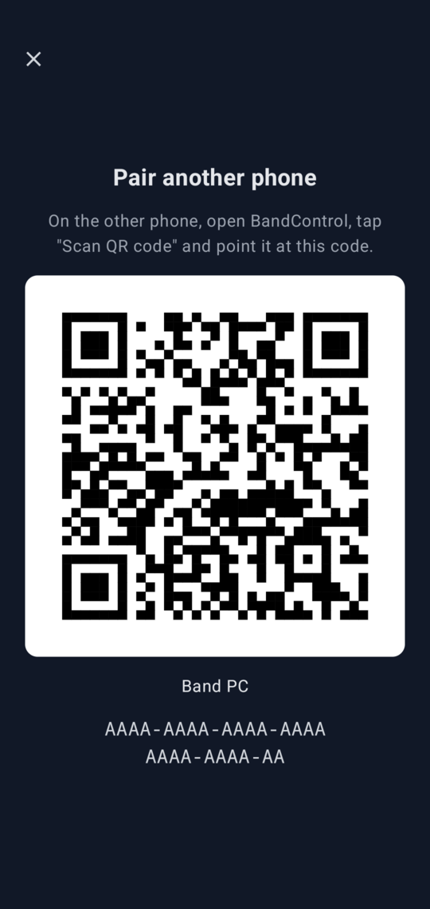

REAPER shows a QR code; scan it with the app or type the code. A paired phone shows the same QR code to the next one, so the rest of the band can pair from it. A phone can be paired with several computers, like a rehearsal laptop and a stage PC: the app connects to the one in range and asks when both are.

<br clear="right">

### Connectivity

Phones connect to the computer directly over Bluetooth Low Energy, without a Wi-Fi network. Only paired phones find the computer, and every session is encrypted. The app reconnects by itself and keeps the screen on while connected.

<!-- features:end -->

## Install

Download the files from the [latest release](https://github.com/nikarh/reaper-bandcontrol/releases/latest), or use
the [website](https://nikarh.github.io/reaper-bandcontrol/).

### Requirements

| | |
| --- | --- |
| REAPER | **5.93 or newer.** Every release from 5.93 (the oldest REAPER for Linux still available) to 7.82 passes the end-to-end tests ([`mise run e2e:reaper-versions`](#development)); CI tests the oldest and the newest on every change, and every week the newest REAPER release. On an older REAPER the extension says so in the console when it loads. Windows and macOS builds use the same REAPER API, they aren't run against old releases. |
| Windows | Windows 10 1803 or newer, x64 or ARM, with a Bluetooth adapter that supports the LE peripheral role (**BandControl: Show status** says when it doesn't). |
| macOS | **macOS 11 Big Sur or newer**, Apple silicon or Intel: every Mac that runs macOS 11 has Bluetooth LE. Tested on macOS 15 (Apple silicon); CI tests the app on the oldest and the newest macOS that GitHub's runners offer, and on Intel. The installer adds the BandControl app, which REAPER starts for Bluetooth, see [macOS](#macos). |
| Linux | x86_64 or aarch64 (e.g. a Raspberry Pi 5) with BlueZ (`bluetoothd`) and glibc 2.35 or newer: Ubuntu 22.04, Debian 12, Fedora 36 and newer. |
| Phones | Android 9 or newer with Bluetooth LE. |

### REAPER extension

Quit REAPER, run the installer, start REAPER again: the actions are under *Actions → Show action list*, starting
with "BandControl".

| Platform | Installer | |
| --- | --- | --- |
| Windows, x64 (most PCs) | `bandcontrol-windows-x64-setup.exe` | For your user, into `%APPDATA%\REAPER`; for a portable REAPER choose its folder. Uninstall from *Settings → Apps*. |
| Windows on ARM | `bandcontrol-windows-arm64-setup.exe` | For REAPER's ARM64EC build. An x64 REAPER running under emulation needs the x64 installer. |
| macOS, Apple silicon and Intel | `bandcontrol-macos.pkg` | The extension into `~/Library/Application Support/REAPER`, the BandControl app into `~/Applications`; no administrator password. See [macOS](#macos) for opening it. |
| Linux | – | Copy the library, see below. |

Until a release is signed with the project's certificates, Windows SmartScreen asks first (*More info → Run anyway*),
and macOS refuses to open the package until you let it through once, see below.

#### macOS

The installer puts the extension and the **BandControl** app into your home folder. BandControl is a small menu bar
app that REAPER starts for Bluetooth, which macOS doesn't let REAPER use itself.

The releases aren't signed by Apple yet, so macOS blocks the installer the first time. Install it in **one** of these
two ways.

##### Option 1: the installer (recommended)

**macOS 15 Sequoia and newer**

1. Double-click `bandcontrol-macos.pkg`. macOS says it was *Not Opened*: click **Done**.
2. Open *System Settings → Privacy & Security*, scroll down and click **Open Anyway**.
3. Click **Open Anyway** again, confirm with Touch ID or your password, and go through the installer.

<p>
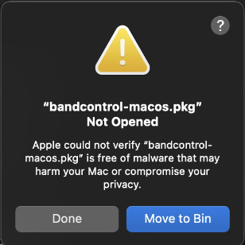
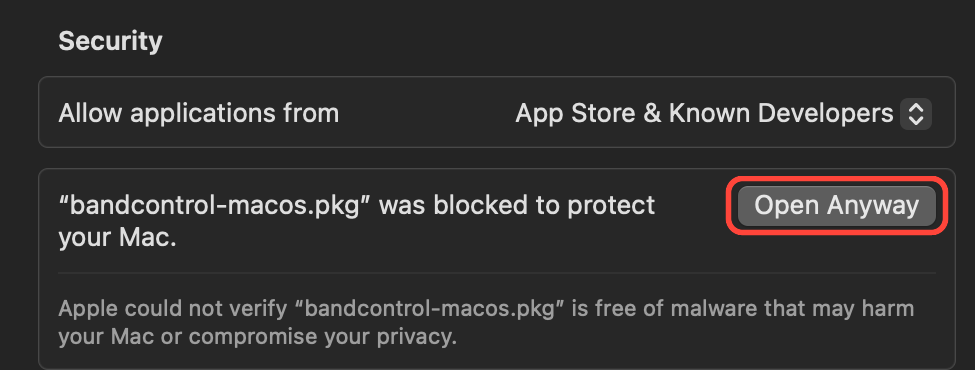
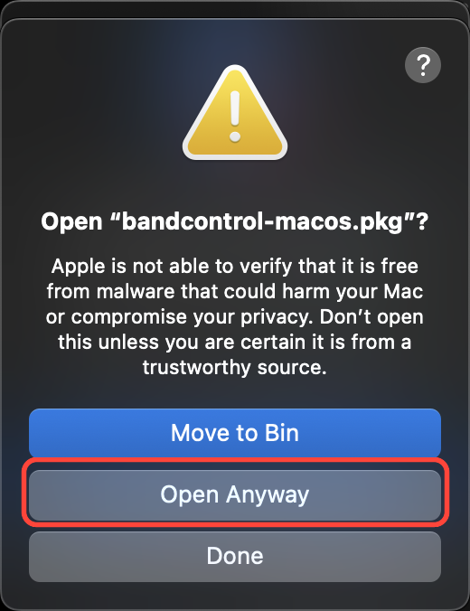
</p>

**macOS 11 to 14**: right-click `bandcontrol-macos.pkg`, choose **Open**, click **Open** again and go through the
installer.

##### Option 2: the Terminal (advanced)

Downloads and installs in one go, for your user, without System Settings or a password:

```sh
cd ~/Downloads && curl -fLO https://github.com/nikarh/reaper-bandcontrol/releases/latest/download/bandcontrol-macos.pkg \
  && installer -pkg bandcontrol-macos.pkg -target CurrentUserHomeDirectory
```

##### Then

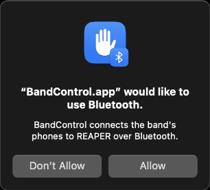

Start REAPER. When macOS asks whether *BandControl.app* may use Bluetooth, click **Allow**.

<br clear="right">

#### Manual install: the plain library

For a portable REAPER, Linux, or to see exactly what goes where: copy the library for your platform into REAPER's
`UserPlugins` folder (in REAPER: *Options → Show REAPER resource path*, then `UserPlugins`) and restart REAPER. The
file name doesn't matter as long as it starts with `reaper_`; an installer puts the same library in the same place.

| Platform | File |
| --- | --- |
| Windows x64 | `reaper_bandcontrol-windows-x86_64.dll` |
| Windows on ARM (ARM64EC REAPER) | `reaper_bandcontrol-windows-arm64ec.dll` |
| macOS | `reaper_bandcontrol-macos-universal.dylib`, and `BandControl-macos.zip`: unzip it and move `BandControl.app` into `Applications` in your home folder (or the main one). Downloaded with a browser both are quarantined and won't run: `xattr -d com.apple.quarantine reaper_bandcontrol-macos-universal.dylib` and `xattr -dr com.apple.quarantine ~/Applications/BandControl.app` once |
| Linux x86_64 | `reaper_bandcontrol-linux-x86_64.so` (into `~/.config/REAPER/UserPlugins`) |
| Linux aarch64 | `reaper_bandcontrol-linux-aarch64.so` |

From source: `mise run install` builds the extension and copies it into REAPER's `UserPlugins` (Linux and macOS; on
macOS it also puts BandControl.app into `~/Applications`).

### Android app

Install `bandcontrol.apk` on every phone (Android 9 or newer with Bluetooth LE). Android asks to allow installing
apps from your browser or file manager the first time. The app needs the *Nearby devices* permission (on Android 11
and older: location, which those versions require for Bluetooth scanning) and the camera only to scan QR codes.
Google Play services are not needed; it runs on de-Googled phones like LineageOS.

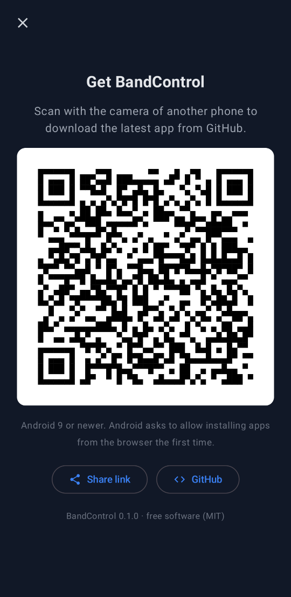

Once one phone has the app, the others don't need this page: menu (⋮) → **About & share the app** shows a QR code
that downloads the latest APK from GitHub when scanned with any phone camera, a **Share link** button for messengers
and a link to the project on GitHub.

<br clear="right">

### Pairing

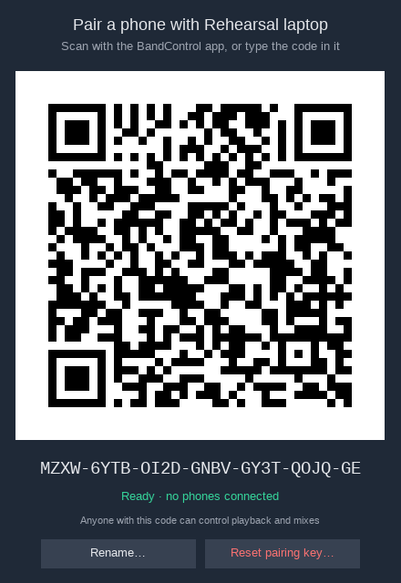

1. In REAPER, run the action **BandControl: Show pairing QR code** (*Actions → Show action list*, or give it a
   toolbar button). A window opens with the QR code, the code to type, the name phones will see and whether
   Bluetooth is up. Make the window bigger and the QR code grows with it, which helps phones on the far side of
   the room. Its size and text follow REAPER's scaling preferences (*Preferences → General → Advanced UI/system
   tweaks*).
2. In the app, tap **Scan QR code**, or type the code.
3. Pair the other phones from the first one: menu (⋮) → **Share pairing with another phone** shows the same QR code.

**On a Mac** the action opens the window of the BandControl app, which also lists the connected phones and can
disconnect one. The app's menu bar icon (three faders) has the same actions; when a MacBook's notch hides it behind
REAPER's menus, hold ⌘ and drag it further right.

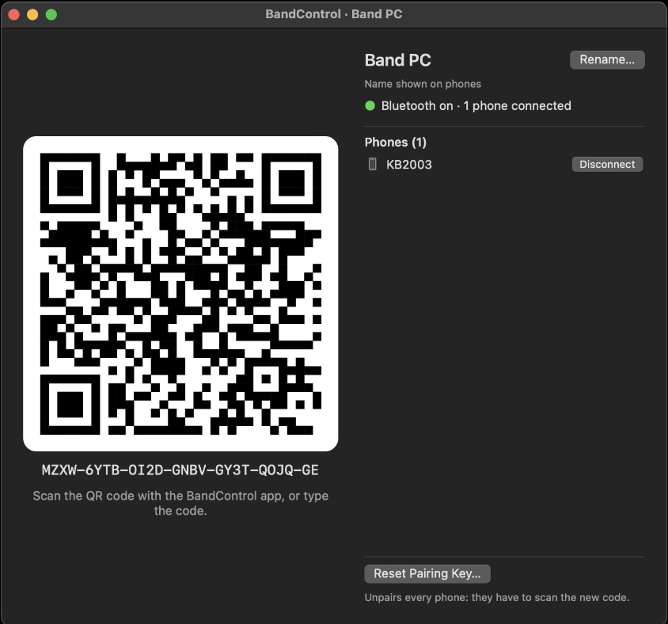

All phones share one pairing code. **Reset pairing key…** in the window (or the action **BandControl: Reset pairing
key**) creates a new one and unpairs every phone; **Rename…** sets the name phones show. **BandControl: Show status**
shows the details, including why Bluetooth doesn't work if it doesn't.

<br clear="right">

### Where pairings are saved, and which computer is which

- **On the computer** the pairing code belongs to the REAPER installation: it is saved in REAPER's settings
  (`reaper-extstate.ini` in the resource folder), so it is the same for every project and survives restarts. A
  second computer, or a second REAPER installation with its own resource folder, has its own code.
- **The name** phones show comes from **BandControl: Set the name shown on phones**, saved in the same place; until
  it is set it's the computer's hostname (`BANDCONTROL_NAME` in the environment overrides both). Give every computer
  a name the band recognizes, like "Rehearsal laptop" or "Stage PC". The app shows it at the top while connected and
  picks up renames by itself.
- **On the phone** the app remembers every computer it was paired with (menu → **Pair with another computer**
  adds one). Each installation has its own code, so the phone only ever finds computers it was paired with.
  - Only one of them in range: the app connects to it by itself.
  - Several in range when the app opens: it asks which one.
  - Another paired computer comes in range while one is in use: the app says so (**Stage PC is nearby**, with a
    **Switch** button) and stays connected to the current one.
  - The menu switches to any paired computer and **Forget** removes the current one.

## Organizing the REAPER project

**BandControl reads the project by its folder names.** Three folders decide what shows up in which tab:

```text
INPUTS/               -> Inputs tab: one track per input (Drums, Bass, Guitar, Vocals)
FOH OUT/              -> FOH tab: front of house, the feeds to the house desk or the PA, each a hardware output
                         receiving its sources
IEM OUT/              -> IEM tab: one mix per musician, a hardware output receiving everything they want to hear
```

The click, backtracks, buses, effect returns and any other tracks can be anywhere else, organized however you
like, as long as they don't land in these folders: a direct child of the Inputs or FOH
folder shows up in that tab, and a track with a hardware output and receives inside the IEM folder is listed as a
mix. Without these folders the Inputs and FOH tabs are hidden and the IEM tab lists every track with a
hardware output and receives. There is nothing to install in the project; the [example project](#example-project)
shows one way to lay it out.

The rules:

1. **Songs are regions.** They must not overlap but may follow each other directly. Markers inside a region are the
   song's parts, used by previous / next. Markers are optional: regions alone are enough.
2. **An IEM mix is a track with a hardware output and at least one receive**, one per band member, receiving every
   source they want to hear (click, backtracks, instruments, vocals). The IEM tab sets the volume and mute of those
   receives and the mix's own volume. Put the mixes in a folder with **IEM** or **Monitor** in its name: then other
   output tracks (spare outputs) are not listed. FOH outputs never are.
3. **Inputs** are the direct children of a top level folder with the word **Input** or **Inputs** in its name (any
   case: "INPUTS", "Band inputs"). Nested tracks (effect returns and the like) are not inputs.
4. **FOH outputs** (front of house: what the audience hears, through the house desk or straight to the PA) are the
   direct children of a top level folder with the word **FOH** or **PA** in its name ("FOH OUT", "To FOH",
   "PA OUT").
5. The **song order** and disabled songs are stored in the project (project state `BANDUI/regions`), shared with
   reaper-remote-bandui.

Inputs and FOH tabs are hidden when the project has no such folder; a reaper-remote-bandui `Mother Project.RPP`
works as it is.

### Example project

[**Download `BandControl-Example.RPP`**](https://raw.githubusercontent.com/nikarh/reaper-bandcontrol/main/examples/BandControl-Example.RPP)
(*right click → Save link as*): a small project laid out this way, to open and look at, or to start from. It
opens in any REAPER from 5.93 on and needs no plugins. The screenshots here are taken from it.

- **Click** (a click plays during every song) and **Backtrack**, at the top level in this example.
- **INPUTS**: Drums, Bass, Guitar and Vocals on hardware inputs 1 to 4.
- **FOH OUT**: FOH Backtrack, FOH Instruments and FOH Vocals on hardware outputs 9 to 11, each receiving its sources.
- **IEM OUT**: Drummer, Bassist, Guitarist and Singer on output pairs 1/2 to 7/8, each receiving all six sources.
- Four songs, Spring, Summer, Autumn and Winter, each in its own color, at REAPER's default 120 BPM, one empty bar
  apart, with markers for their parts (Verse, Chorus, Outro, ...).

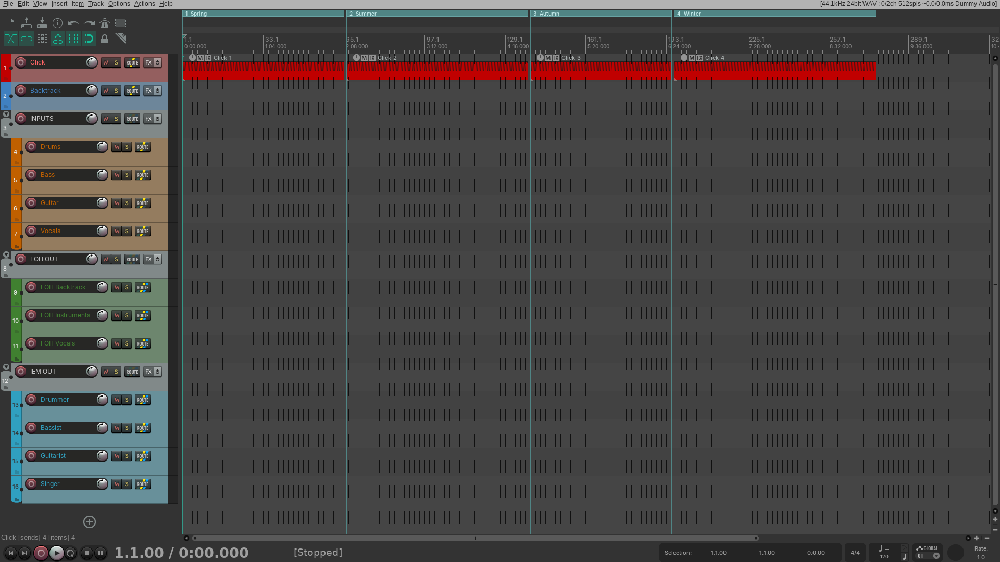

## How it works

```text
 REAPER ── extension (Rust) ─────────────────────────┐            Android app (Kotlin, Compose)
   timer callback (~30 Hz)                            │
   ├─ reads tracks, receives, regions, transport      │  Bluetooth LE GATT   ┌──────────────────────┐
   ├─ engine: what changed, who needs it              ├─────────────────────►│ session, state, UI   │
   └─ server thread: sessions, crypto, BLE/TCP ───────┘◄─────────────────────┤ commands from faders │
                                                                             └──────────────────────┘
```

- **Transport.** The extension registers a GATT service whose UUID is derived from the pairing secret, with one
  characteristic phones write to and one they subscribe to. Phones scan for that UUID, so only paired phones even
  see the computer. Messages are [protobuf](proto/bandcontrol.proto) in a small framing layer that splits them into
  packets of the negotiated Bluetooth MTU. Linux uses BlueZ, macOS CoreBluetooth, Windows WinRT. On macOS the
  Bluetooth part runs in the BandControl app, which REAPER starts through Launch Services so that macOS gives it a
  Bluetooth permission of its own; the extension and the app exchange the (still encrypted) packets over a Unix
  socket, `~/Library/Application Support/BandControl/helper.sock`. Sessions and keys stay in the extension.
- **Sync policy.** A phone that connects gets the full state (tracks, volumes, receives, regions, markers, song
  order) and the transport. After that: the play position about once a second (the app extrapolates in between),
  volume and mute changes as small deltas the moment they happen, and the full state again, debounced by a second,
  when the project structure changes (tracks, receives, regions, markers). Meters are opt-in: the app subscribes to
  the tracks on screen and gets their peaks ten times a second, one byte per track; silence is sent once.
- **Commands.** Faders send at most every 50 ms while dragged; the extension applies commands on REAPER's main
  thread and the result comes back as a delta to every phone, so all phones stay in sync. The last change wins,
  whether it came from a phone or the engineer at the computer.
- **Security.** The 128-bit pairing secret derives the service UUID and an authentication key (HKDF-SHA256). A
  session starts with a mutual challenge-response (HMAC-SHA256): the phone proves it knows the secret, and the
  computer proves it too, so a phone can't be lured to an impostor. All further messages are encrypted and
  authenticated with ChaCha20-Poly1305; broadcast messages use a group key handed out to authenticated phones.
- **Threads.** REAPER's API is only touched from REAPER's main thread (the timer callback); Bluetooth and crypto run
  on a separate thread and exchange messages with it, so a slow phone never stalls REAPER's user interface.

## Quirks and limitations

- **Range.** Bluetooth LE reaches roughly 10 m through a stage, more with line of sight. Keep the computer's
  adapter unobstructed; a USB adapter on a short extension cable helps with laptops in flight cases.
- **Number of phones.** Adapters handle a limited number of simultaneous connections, usually 5 to 10. A typical
  band fits; a big ensemble may hit the adapter's limit.
- **macOS.** macOS only lets an application use Bluetooth if its `Info.plist` declares it, and REAPER's doesn't,
  so the BandControl app does it for the extension (see [macOS](#macos)). The app needs no administrator rights and
  quits a few seconds after REAPER. Until the releases are signed, macOS asks for the Bluetooth permission again
  after an update. Like Windows, macOS can't drop a phone's Bluetooth connection: **Disconnect** in the app ends the
  phone's session and ignores it from then on, and the phone shows that the computer disconnected it.
- **Windows.** Needs Windows 10 1803 or newer and an adapter that supports the peripheral role. Windows can't drop a
  connection from the computer's side, so a rejected phone stays connected at the Bluetooth level until it leaves.
- **Gain and meters.** "Gain" on the Inputs and FOH tabs is the track volume (the fader in REAPER), and meters show
  the level after it. Clip indicators light at 0 dBFS and stay lit until tapped.
- **Faders.** Faders move only with horizontal drags and relative to their position: a tap or a vertical scroll
  never changes a level. The range is -∞ to +12 dB with a detent at 0 dB.
- **Changing the pairing code.** After **Reset pairing key** every phone has to pair again; over Bluetooth a phone
  with an old code doesn't find the computer anymore, and the app says so.

## Verifying downloads

Every release contains `SHA256SUMS` and its signature `SHA256SUMS.asc`, made with the project's key
([`docs/signing-key.asc`](docs/signing-key.asc)); the APK is additionally signed with the app's release key.

```sh
gpg --import signing-key.asc
gpg --verify SHA256SUMS.asc SHA256SUMS
sha256sum --ignore-missing -c SHA256SUMS
```

## Development

[mise](https://mise.jdx.dev) pins every toolchain (Rust, Java, Gradle, Android SDK, cargo-deny, git-cliff,
actionlint, shellcheck, taplo):

```sh
mise install
mise run android:sdk   # once: Android SDK packages into .android-sdk
```

| Layer | Command | Needs |
| --- | --- | --- |
| Rust unit and integration tests (protocol, engine, server over TCP, .RPP parser, the macOS app's relay between the extension and a fake Bluetooth) | `mise run test` | – |
| The macOS app started through Launch Services, talking to the extension's server over its socket | `mise run e2e:macos` | macOS |
| Lints: clippy for Linux, macOS and Windows, cargo-deny, rustfmt, taplo, shellcheck, actionlint, actions pinned to commit SHAs and allowed, docs check | `mise run lint` | – |
| Extension in REAPER itself, headless (band fixture and Mother Project) | `mise run e2e:reaper` | REAPER, `cage` or Xvfb |
| The same against REAPER releases from 5.93 to 7.82, downloaded on demand | `mise run e2e:reaper-versions [VERSION...]` | `cage` or Xvfb |
| Kotlin protocol and state tests, Kotlin client against the Rust simulator | `mise run android:test` | – |
| Android lint and ktlint | `mise run android:lint` | – |
| App on a phone against the simulated example project | `mise run android:e2e [tcp\|ble]` | phone (adb) |
| App on a phone against headless REAPER with the example project | `mise run android:e2e:reaper [ble\|tcp]` | phone, REAPER |

Tools:

- `cargo run -p bandctl -- sim --project band --ble --activity` simulates REAPER as a Bluetooth peripheral, moving
  faders and the playhead; `--tcp 127.0.0.1:47011` serves TCP. `--project band` is the test fixture
  ([`tests/fixtures/Band Project.RPP`](tests/fixtures/Band%20Project.RPP): a full band's layout with markers, a custom
  song order and a skipped song, which the tests need), `--project example` the example project, `--project
  FILE.RPP` any project. `bandctl pair` prints a pairing code, `bandctl client` prints what a server sends. On
  macOS `--ble --app` serves through the BandControl app, like the extension does.
- `mise run reaper` starts an isolated headless REAPER with the extension and the band fixture (`--project FILE` for
  another); lines typed on stdin go to REAPER's web API (`SET/TRACK/13/VOL/0.5`), `screenshot FILE.png` saves a
  screenshot.
- `mise run package:windows x64|arm64 [DLL]` and `mise run package:macos [DYLIB APP]` build the installers, signed
  when the signing variables are set (see [`docs/RELEASING.md`](docs/RELEASING.md)). The Windows one needs
  `makensis` (NSIS) and, without a DLL argument, Windows; the macOS one needs macOS and also writes
  `BandControl-macos.zip`. The oldest supported macOS is `MACOSX_DEPLOYMENT_TARGET` in
  [`.cargo/config.toml`](.cargo/config.toml).
- `scripts/make-example-project.py` and `scripts/make-band-fixture.py` regenerate the two projects.
- `mise run android:deploy [-s SERIAL] [pairing-url]` installs and starts the app; with several devices in
  `adb devices` it asks which one (or takes `-s` / `ANDROID_SERIAL`), like the other phone scripts. A pairing URL
  with `&t=127.0.0.1:PORT` makes debug builds connect over TCP through `adb reverse`. `scripts/android-emulator.sh` boots a headless
  emulator (after `mise run android:emulator-sdk`) when there's no phone.

Extension environment variables: `BANDCONTROL_SECRET` (pairing code), `BANDCONTROL_TCP` (also listen on TCP),
`BANDCONTROL_BLE=0`, `BANDCONTROL_NAME`, `BANDCONTROL_LOG` (tracing filter); on macOS `BANDCONTROL_HELPER_SOCKET`
(the app's socket) and `BANDCONTROL_APP` (the app to start). It logs to `bandcontrol.log` in REAPER's resource
directory, the macOS app to `~/Library/Logs/BandControl.log`.

### Docs, screenshots and releases

- **Features** are described once in [`docs/features.toml`](docs/features.toml); `mise run docs` renders them into
  this README and the website (`site/`), and `mise run lint` fails when the README is out of date.
- **Screenshots** in `docs/screenshots` are generated: `mise run docs:screenshots` runs `ScreenshotTest` on a phone
  or emulator against the simulator, and takes REAPER screenshots in a headless REAPER. The *Docs* workflow does the
  same on GitHub and opens a pull request when they change.
- **Commits** follow [Conventional Commits](https://www.conventionalcommits.org); [git-cliff](cliff.toml) turns
  `feat`, `fix`, `perf` and `docs` commits into [CHANGELOG.md](CHANGELOG.md) and the release notes.
- **Releases** are made by the *Create a release PR* workflow (choose patch / minor / major), which bumps the
  version and changelog in a pull request; merging it tags the release, and the *Publish* workflow builds, signs and
  uploads every artifact. See [docs/RELEASING.md](docs/RELEASING.md) for the one-time setup.

Agents and contributors: [AGENTS.md](AGENTS.md) describes the conventions in one place.

## License

[MIT](LICENSE)
