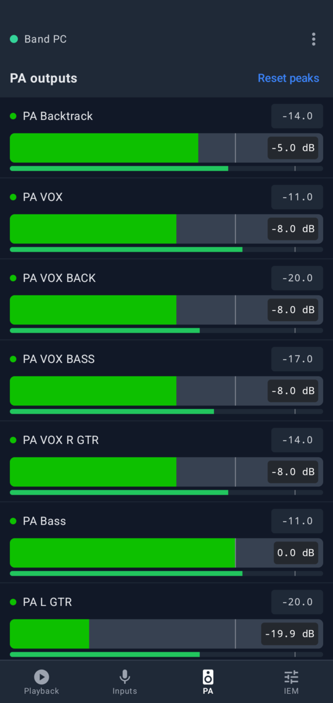

# BandControl for REAPER

[](https://github.com/nikarh/reaper-bandcontrol/actions/workflows/check.yml)
[](https://github.com/nikarh/reaper-bandcontrol/releases/latest)
[](LICENSE)

Control REAPER from the band's phones over Bluetooth: playback and setlist, input and PA levels, and a personal
in-ear mix for every band member. No Wi-Fi, no tethering, no IP addresses.

BandControl is two parts: a **REAPER extension** (Windows, macOS, Linux) that turns the computer into a Bluetooth
Low Energy device, and an **Android app** that every band member installs.

> **Status:** the Android app is the only client for now. An **iOS app is planned** but doesn't exist yet. The app
> is not on **Google Play** or **F-Droid** yet (both planned); install the APK from the
> [releases](https://github.com/nikarh/reaper-bandcontrol/releases/latest). The Linux Bluetooth backend is tested
> daily; the macOS and Windows backends are implemented but have seen little real hardware so far.

## Why this exists

BandControl supersedes [reaper-remote-bandui](https://github.com/nikarh/reaper-remote-bandui), a web page for
REAPER's built-in web interface that bands use for the same job. The web page works well on a good Wi-Fi network.
Most rehearsal rooms and venues don't have one, so in practice one phone shares its hotspot, the computer joins it,
and every musician types the computer's IP address and port into a browser, and again after the hotspot drops.

BandControl removes the network entirely:

- **No network setup.** The computer is a Bluetooth device; phones connect to it directly, wherever you are.
- **Pair once.** Scan a QR code from REAPER, or from a bandmate's phone. After that the app finds the computer by
  itself, every time, and reconnects when the connection drops.
- **Secure by default.** Only paired phones can find the computer, and every session is encrypted. A stranger in
  the audience can't change your monitor mix.
- **Built for the stage.** Faders that don't jump when touched or scrolled over, meters with clip indicators for
  inputs and PA outputs, a setlist editor, plain-language connection status, and the screen stays on while
  connected.
- **Compatible.** The same project conventions as reaper-remote-bandui; the song order it stores is shared.

## Features

<!-- features:start -->
<!-- Generated from docs/features.toml by scripts/build-docs.py, edit there. -->

### Playback and setlist


Play, pause, stop, record and repeat. The songs (regions) are listed in the band's order with their progress; tap one to jump to it. Previous / next step through the parts of a song (markers) and continue with the next song in the setlist. The setlist can be reordered and songs disabled right on the phone; the order is stored in the REAPER project, compatible with reaper-remote-bandui.

<br clear="right">

### Input levels and gain


A live meter for every input with its peak level, and a clip indicator that stays lit until you tap it, so you see which input clipped during the last song. The fader sets the input's gain (its track volume) on a dB scale up to +12 dB.

<br clear="right">

### PA outputs



The same meters and faders for the outputs that go to the front of house, so whoever runs the PA can check and adjust levels from the stage.

<br clear="right">

### Personal in-ear mixes


Every band member picks their own mix and sets the level of each source: click, backtracks, other instruments, vocals. Faders only move when dragged sideways, relative to where they are, so a tap or a scroll never changes a level by accident. Mutes and the overall mix level are one tap away, and changes made in REAPER show up instantly.

<br clear="right">

### Pair once, share by QR code


REAPER shows a QR code; scan it with the app (no Google services needed) or type the code. A paired phone shows the same QR code to the next one, so the whole band is set up in a minute without touching the computer again.

<br clear="right">

### No Wi-Fi, no IP addresses

Phones talk to the computer over Bluetooth Low Energy, wherever you play: no router, no tethering, no addresses to type. Only paired phones can find the computer, and every session is encrypted. The app reconnects by itself and keeps the screen on while connected.

### Works with your REAPER project

No special plugins or routing: songs are regions, an IEM mix is a track with a hardware output and receives, and folders named "Inputs", "PA" and "IEM" decide what shows up in which tab. Existing reaper-remote-bandui projects work as they are.


<!-- features:end -->

## Install

Download the files from the [latest release](https://github.com/nikarh/reaper-bandcontrol/releases/latest), or use
the [website](https://nikarh.github.io/reaper-bandcontrol/).

### REAPER extension

Copy the file for your platform into REAPER's `UserPlugins` folder (in REAPER: *Options → Show REAPER resource
path*, then open `UserPlugins`) and restart REAPER. The file name doesn't matter as long as it starts with
`reaper_`.

| Platform | File | Notes |
| --- | --- | --- |
| Windows 10 1803+ (x64) | `reaper_bandcontrol-windows-x86_64.dll` | Needs an adapter that supports the Bluetooth LE peripheral role (most built-in ones do). |
| macOS (Apple Silicon and Intel) | `reaper_bandcontrol-macos-universal.dylib` | Not notarized yet: run `xattr -d com.apple.quarantine <file>` once. See [quirks](#quirks-and-limitations). |
| Linux x86_64 | `reaper_bandcontrol-linux-x86_64.so` | Needs BlueZ (`bluetoothd`); the adapter is powered on automatically. |
| Linux aarch64 | `reaper_bandcontrol-linux-aarch64.so` | Same as above, e.g. a Raspberry Pi 5. |

From source: `mise run install` builds the extension and copies it into REAPER's `UserPlugins` (Linux and macOS).

### Android app

Install `bandcontrol.apk` on every phone (Android 9 or newer with Bluetooth LE). Android asks to allow installing
apps from your browser or file manager the first time. The app needs the *Nearby devices* permission (on Android 11
and older: location, which those versions require for Bluetooth scanning) and the camera only to scan QR codes.
Google Play services are not needed; it runs on de-Googled phones like LineageOS.

### Pairing

1. In REAPER, run the action **BandControl: Show pairing QR code** (*Actions → Show action list*). A page with a QR
   code and the pairing code opens in the browser.
2. In the app, tap **Scan QR code**, or type the code.
3. Pair the other phones from the first one: menu (⋮) → **Share pairing with another phone** shows the same QR code.

All phones share one pairing code. **BandControl: Reset pairing key** creates a new one and unpairs every phone.
**BandControl: Show status** shows whether Bluetooth is up and how many phones are connected.

## Organizing the REAPER project

BandControl reads the project as it is; there is nothing to install in the project. A few conventions decide what
the app shows:

1. **Songs are regions.** They must not overlap but may follow each other directly. Markers inside a region are the
   song's parts, used by previous / next. Most bands need none: regions alone are enough.
2. **An IEM mix is a track with a hardware output and at least one receive**, one per band member, receiving every
   source they want to hear (click, backtracks, instruments, vocals). The IEM tab sets the volume and mute of those
   receives and the mix's own volume. Put the mixes in a folder named like **IEM** or **Monitor**: then other output
   tracks (PA feeds, a debug mix) are not listed.
3. **Inputs** are the direct children of a top level folder named like **Inputs**. Nested tracks (vocal effects,
   MIDI helpers) are not inputs.
4. **PA outputs** are the direct children of a top level folder with **PA** in its name.
5. The **song order** and disabled songs are stored in the project (project state `BANDUI/regions`), shared with
   reaper-remote-bandui.

Inputs and PA tabs are hidden when the project has no such folder; a reaper-remote-bandui `Mother Project.RPP`
works as it is.

| Inputs folder | PA and IEM folders |
| --- | --- |
|  |  |

### Example project

[`tests/fixtures/Band Project.RPP`](tests/fixtures/Band%20Project.RPP) has the layout of a real band's live project,
with invented songs and tempos, band members named by instrument, and the few markers real projects have. It opens
in any REAPER (no third party plugins) and is a good template. It's also what every screenshot and most tests use.

```text
Click, Cues, ...    helper tracks; a click plays during every song
BACKTRACKS/                                rehearsal stems, backtracks
INPUTS/                              -> Inputs tab
  Drums input, Bass input, L/R GTR input   (guitars run at +6 dB)
  VOX input/  VOX BASS input/  VOX R GTR input/   vocals, nested helper tracks are not inputs themselves
IEM VOCALS/               vocals processed for the in-ears, receive from the vocal inputs
PA OUT/                            -> PA tab: 8 outputs to the front of house, each receiving one source
IEM OUT/   -> IEM tab: Drums, Left guitar, Right guitar, Bass, Vocals (13-15 receives)
Spare mix, Spare mix               outputs outside the IEM folder, not listed
```

## How it works

```text
 REAPER ── extension (Rust) ─────────────────────────┐            Android app (Kotlin, Compose)
   timer callback (~30 Hz)                            │
   ├─ reads tracks, receives, regions, transport      │  Bluetooth LE GATT   ┌──────────────────────┐
   ├─ engine: what changed, who needs it              ├─────────────────────►│ session, state, UI   │
   └─ server thread: sessions, crypto, BLE/TCP ───────┘◄─────────────────────┤ commands from faders │
                                                                             └──────────────────────┘
```

- **Transport.** The extension registers a GATT service whose UUID is derived from the pairing secret, with one
  characteristic phones write to and one they subscribe to. Phones scan for that UUID, so only paired phones even
  see the computer. Messages are [protobuf](proto/bandcontrol.proto) in a small framing layer that splits them into
  packets of the negotiated Bluetooth MTU. Linux uses BlueZ, macOS CoreBluetooth, Windows WinRT.
- **Sync policy.** A phone that connects gets the full state (tracks, volumes, receives, regions, markers, song
  order) and the transport. After that: the play position about once a second (the app extrapolates in between),
  volume and mute changes as small deltas the moment they happen, and the full state again, debounced by a second,
  when the project structure changes (tracks, receives, regions, markers). Meters are opt-in: the app subscribes to
  the tracks on screen and gets their peaks ten times a second, one byte per track; silence is sent once.
- **Commands.** Faders send at most every 50 ms while dragged; the extension applies commands on REAPER's main
  thread and the result comes back as a delta to every phone, so all phones stay in sync. The last change wins,
  whether it came from a phone or the engineer at the computer.
- **Security.** The 128-bit pairing secret derives the service UUID and an authentication key (HKDF-SHA256). A
  session starts with a mutual challenge-response (HMAC-SHA256): the phone proves it knows the secret, and the
  computer proves it too, so a phone can't be lured to an impostor. All further messages are encrypted and
  authenticated with ChaCha20-Poly1305; broadcast messages use a group key handed out to authenticated phones.
- **Threads.** REAPER's API is only touched from REAPER's main thread (the timer callback); Bluetooth and crypto run
  on a separate thread and exchange messages with it, so a slow phone never stalls the audio engine's UI thread.

## Quirks and limitations

- **Range.** Bluetooth LE reaches roughly 10 m through a stage, more with line of sight. Keep the computer's
  adapter unobstructed; a USB adapter on a short extension cable helps with laptops in flight cases.
- **Number of phones.** Adapters handle a limited number of simultaneous connections, usually 5 to 10. A typical
  band fits; a big ensemble may need a second adapter-sized compromise.
- **macOS.** macOS only lets an application use Bluetooth if its `Info.plist` declares it
  (`NSBluetoothAlwaysUsageDescription`). The extension checks this instead of letting macOS terminate REAPER; if
  REAPER's bundle lacks the key, **Show status** says so and Bluetooth stays off. The extension is not notarized yet
  (see the `xattr` step above).
- **Windows.** Needs Windows 10 1803 or newer and an adapter that supports the peripheral role. Windows can't drop a
  connection from the computer's side, so a rejected phone stays connected at the Bluetooth level until it leaves.
- **Gain and meters.** "Gain" on the Inputs and PA tabs is the track volume (the fader in REAPER), and meters show
  the level after it. Clip indicators light at 0 dBFS and stay lit until tapped.
- **Faders.** Faders move only with horizontal drags and relative to their position: a tap or a vertical scroll
  never changes a level. The range is -∞ to +12 dB with a detent at 0 dB.
- **Changing the pairing code.** After **Reset pairing key** every phone has to pair again; over Bluetooth a phone
  with an old code simply doesn't find the computer anymore, and the app says so.
- **Sideloading.** Until the app is on Google Play and F-Droid, Android shows the usual warnings for apps installed
  from an APK.

## Verifying downloads

Every release contains `SHA256SUMS` and its signature `SHA256SUMS.asc`, made with the project's key
([`docs/signing-key.asc`](docs/signing-key.asc)); the APK is additionally signed with the app's release key.

```sh
gpg --import signing-key.asc
gpg --verify SHA256SUMS.asc SHA256SUMS
sha256sum --ignore-missing -c SHA256SUMS
```

## Development

[mise](https://mise.jdx.dev) pins every toolchain (Rust, Java, Gradle, Android SDK, cargo-deny, git-cliff,
actionlint, shellcheck, taplo):

```sh
mise install
mise run android:sdk   # once: Android SDK packages into .android-sdk
```

| Layer | Command | Needs |
| --- | --- | --- |
| Rust unit and integration tests (protocol, engine, server over TCP, .RPP parser) | `mise run test` | – |
| Lints: clippy for Linux, macOS and Windows, cargo-deny, rustfmt, taplo, shellcheck, actionlint, docs check | `mise run lint` | – |
| Extension in a real, headless REAPER (example and Mother Project) | `mise run e2e:reaper` | REAPER, `cage` or Xvfb |
| Kotlin protocol and state tests, Kotlin client against the Rust simulator | `mise run android:test` | – |
| Android lint and ktlint | `mise run android:lint` | – |
| App on a phone against the simulated example project | `mise run android:e2e [tcp\|ble]` | phone (adb) |
| App on a phone against headless REAPER with the example project | `mise run android:e2e:reaper [ble\|tcp]` | phone, REAPER |

Tools:

- `cargo run -p bandctl -- sim --project band --ble --activity` simulates REAPER with the example project as a
  Bluetooth peripheral, moving faders and the playhead; `--tcp 127.0.0.1:47011` serves TCP, `--project FILE.RPP`
  simulates any project. `bandctl pair` prints a pairing code, `bandctl client` prints what a server sends.
- `mise run reaper` starts an isolated headless REAPER with the extension and the example project; lines typed on
  stdin go to REAPER's web API (`SET/TRACK/40/VOL/0.5`), `screenshot FILE.png` saves a screenshot.
- `mise run android:deploy [pairing-url]` installs and starts the app; a pairing URL with `&t=127.0.0.1:PORT`
  makes debug builds connect over TCP through `adb reverse`. `scripts/android-emulator.sh` boots a headless
  emulator (after `mise run android:emulator-sdk`) when there's no phone.

Extension environment variables: `BANDCONTROL_SECRET` (pairing code), `BANDCONTROL_TCP` (also listen on TCP),
`BANDCONTROL_BLE=0`, `BANDCONTROL_NAME`, `BANDCONTROL_LOG` (tracing filter). It logs to `bandcontrol.log` in REAPER's
resource directory.

### Docs, screenshots and releases

- **Features** are described once in [`docs/features.toml`](docs/features.toml); `mise run docs` renders them into
  this README and the website (`site/`), and `mise run lint` fails when the README is out of date.
- **Screenshots** in `docs/screenshots` are generated: `mise run docs:screenshots` runs `ScreenshotTest` on a phone
  or emulator against the simulator, and takes REAPER screenshots in a headless REAPER. The *Docs* workflow does the
  same on GitHub and opens a pull request when they change.
- **Commits** follow [Conventional Commits](https://www.conventionalcommits.org); [git-cliff](cliff.toml) turns
  `feat`, `fix`, `perf` and `docs` commits into [CHANGELOG.md](CHANGELOG.md) and the release notes.
- **Releases** are made by the *Create a release PR* workflow (choose patch / minor / major), which bumps the
  version and changelog in a pull request; merging it tags the release, and the *Publish* workflow builds, signs and
  uploads every artifact. See [docs/RELEASING.md](docs/RELEASING.md) for the one-time setup.

Agents and contributors: [AGENTS.md](AGENTS.md) describes the conventions in one place.

## License

[MIT](LICENSE)
